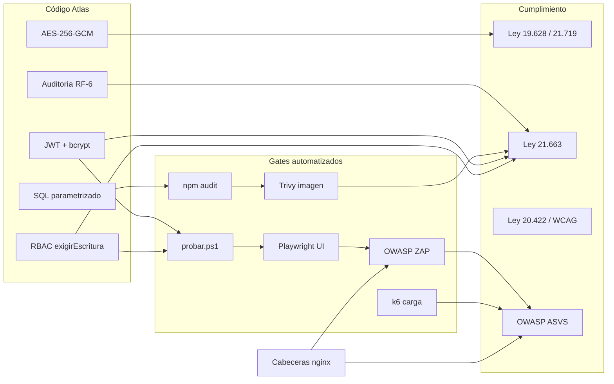

# Diagrama de controles de seguridad automatizados — Atlas EP3

El diagrama integra controles del código, gates automáticos y el vínculo normativo (IE3 del encargo / IE4 de la defensa).

## Lectura del diagrama

| Control | Cómo se verifica | Norma / práctica |
|---|---|---|
| JWT 15 min + bcrypt costo 12 | `probar.ps1` login 200/401 | 21.663 · NFR-SEG-2/9 |
| RBAC editor solo lectura | POST/DELETE → 403 | 21.663 · RB-4 · NFR-SEG-4 |
| Consultas `$1,$2` | Revisión + ausencia de inyección en casos | 21.663 · NFR-SEG-5 · OWASP |
| AES-GCM contacto/banco | Código + no aparece en claro en listados | 19.628 / 21.719 · NFR-SEG-3 |
| Auditoría de acciones | GET auditoría + Playwright | 21.663 · RF-6 |
| Cabeceras nginx | ZAP antes/después (8 → 4 WARN) | OWASP · clickjacking/MIME |
| SCA / imagen | npm audit + Trivy | 21.663 (gestión de vulnerabilidades) |
| Carga 200 VU | k6 p95 | NFR-PERF · calidad sostenible |

Figura generada para el informe: `evidencias/atlas/capturas/diagrama_controles.png`.
